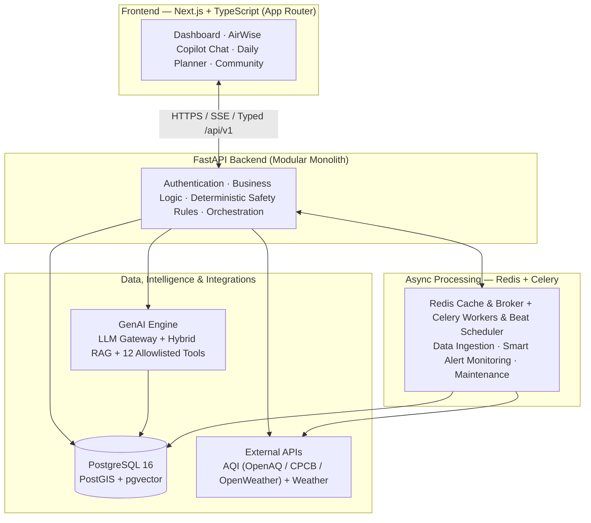

# AirWise AI

> **Breathe Smarter. Live Cleaner. Act Together.**

**AirWise AI** is a production-oriented, GenAI-powered smog and air pollution lifestyle assistant built to help families, commuters, caregivers, students, and neighborhood communities navigate urban air pollution safely and sustainably.

It strictly separates three impact dimensions so users receive scientifically responsible, trustworthy guidance:
- **Personal Exposure Reduction** — Practical actions that reduce the pollution you and your household breathe today.
- **Emission Reduction** — Lower-emission mobility and household energy choices when exposure conditions are safe.
- **Community Impact** — Privacy-preserving neighborhood initiatives and collective action tracking.

---

## Architecture at a Glance



---

## Repository Structure

```text
airwise/
├── frontend/                       # Next.js (App Router) + Strict TypeScript + Tailwind + shadcn/ui
├── backend/                        # Python 3.12+ FastAPI + SQLAlchemy 2.x Async + Celery + GenAI Engine
├── api/                            # Vercel Python Serverless entrypoint mounting backend FastAPI app
├── infrastructure/                 # Docker init scripts, Prometheus/OTel monitoring, Vercel deployment docs
│   ├── docker/
│   ├── monitoring/
│   └── deployment/
├── .github/workflows/              # CI validation & gated Vercel CD pipelines
├── vercel.json                     # Zero-cost Vercel Next.js + FastAPI rewrite & Cron configuration
├── docker-compose.yml              # Multi-service stack (frontend, backend, worker, scheduler, postgres, redis)
└── Makefile                        # Developer & operations workflow commands
```

---

## Quick Start

### Option A: Full Stack with Docker Compose

```bash
# 1. Initialize local environment files
cp backend/.env.example backend/.env
cp frontend/.env.example frontend/.env.local

# 2. Launch PostgreSQL (PostGIS + pgvector), Redis, FastAPI, Celery Worker/Scheduler, and Next.js
docker compose up --build
```

- **Frontend:** `http://localhost:3000`
- **Backend API & OpenAPI Docs:** `http://localhost:8000/docs`
- **Liveness / Readiness Probes:** `http://localhost:8000/health/live` · `http://localhost:8000/health/ready`

### Option B: Local Native Development

```bash
# Backend (Python 3.12+)
cd backend
python -m venv .venv
# Windows: .venv\Scripts\activate | macOS/Linux: source .venv/bin/activate
pip install -e ".[dev]"
uvicorn app.main:app --reload --port 8000

# Frontend (Node.js 22+)
cd ../frontend
npm install
npm run dev
```

> **Development Fixtures Notice:** Without environmental-provider credentials, explicitly select `AIR_QUALITY_PROVIDER=fixture` in development. All synthetic readings carry `is_development_fixture: true`. Without `GEMINI_API_KEY`, the assistant reports a safe-guidance fallback; it never simulates a model response.

### Gemini Assistant (Phase 4)

Set backend-only `GEMINI_API_KEY`, run `alembic upgrade head`, then
`python -m scripts.ingest_knowledge` from `backend/` to embed the reviewed source summaries.
PostgreSQL with pgvector and Redis are required for live hybrid retrieval and daily AI budgets.
Sign in and open `/dashboard/assistant`; sending a question requires explicit Gemini consent.
See [the development guide](./docs/development.md#5-gemini-assistant-and-trusted-knowledge) for details.

---

## Zero-Cost Cloud Deployment (Vercel Free Tier)

AirWise AI deploys at **$0/month** on **Vercel** (`vercel.json` + `api/index.py`) with same-origin `/api/v1/*` rewrites, **Vercel Cron** daily maintenance, free managed **Neon/Supabase PostgreSQL 16 (PostGIS + pgvector)**, and **Upstash Serverless Redis**. See [`docs/deployment.md`](./docs/deployment.md) and [`infrastructure/deployment/README.md`](./infrastructure/deployment/README.md) for setup instructions.

---

## License

MIT — see [`LICENSE`](./LICENSE).
