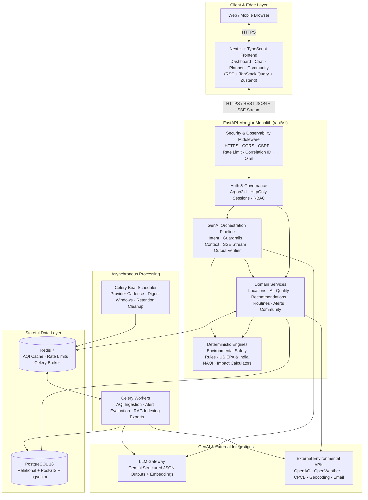
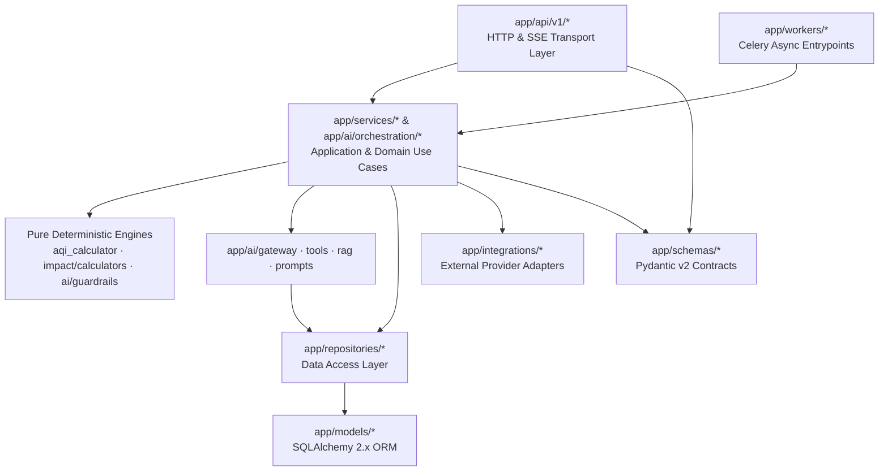

# System Architecture: AirWise AI (`architecture.md`)

AirWise AI uses a **scalable modular monolith** backend paired with a **Next.js App Router** frontend, **PostgreSQL (PostGIS + pgvector)** unified operational/spatial/vector persistence, **Redis** caching & broker infrastructure, and **Celery** background workers.

---

## 1. High-Level System Architecture

---

## 2. Backend Module Dependency Rules

To keep the modular monolith clean and prevent circular imports, dependencies flow strictly top-to-bottom:

### Key Boundaries
1. **Transport Isolation:** `app/services/*` and `app/repositories/*` never depend on FastAPI `Request`, `Response`, or `HTTPException`. Domain errors subclass `AirWiseError` (`app/core/exceptions.py`) and map centrally to HTTP status codes and error envelopes.
2. **Deterministic Isolation:** `aqi_calculator.py`, `impact/calculators.py`, and `ai/guardrails/` are pure, deterministic Python modules with zero network or LLM dependencies—making them 100% unit-testable and auditable.
3. **Provider Independence:** External AQI, weather, geocoding, email, and LLM vendors sit behind typed Python `Protocol` / ABC interfaces so primary-to-fallback failover or provider swaps never leak vendor payloads into domain models.

---

## 3. Core Data Flows

### 3.1 Real-Time AQI Read & Scheduled Ingestion Flow
1. **Scheduled Ingestion:** `Celery Beat` enqueues station/city refresh jobs per provider cadence -> `Celery Worker` calls primary AQI adapter via HTTPX (with timeout + circuit breaker; falls back to secondary provider on failure) -> normalizes pollutant units -> persists immutable time-series row in `air_quality_measurements` -> warms Redis cache key `aqi:{standard}:{location_key}` with provider TTL.
2. **Dashboard Read (`GET /api/v1/air-quality/current`):** FastAPI checks Redis cache -> on hit, returns normalized reading + selected AQI standard sub-index + freshness metadata (`p95 < 300 ms`). If upstream providers are degraded and cached reading exceeds freshness window, serves latest verified reading explicitly flagged `is_stale: true`—never silently masking staleness.

### 3.2 AirWise Copilot Streaming Chat Flow (`POST /api/v1/assistant/chat/stream`)
1. Authenticate user, validate CSRF & per-user token/request rate limits, and assign `request_id`.
2. Classify intent and run pre-LLM medical red-flag & prompt-injection guardrails.
3. Assemble consented coarse location, household preferences, and rolling conversation summary.
4. Execute allowlisted tools (e.g., `get_current_air_quality`, `calculate_transport_emissions`, `retrieve_environmental_guidelines` via `pgvector` hybrid search), streaming `event: status` SSE updates to the UI.
5. Evaluate deterministic safety overrides (e.g., blocking outdoor aerobic exercise recommendations when `India NAQI > 300` or `US EPA > 200`).
6. Stream LLM structured synthesis (`event: delta`), validate final payload against Pydantic schema, cross-check cited document IDs and numerical fidelity against tool outputs, persist turn + `ai_generation_metadata`, and emit `event: complete`.

### 3.3 Smart Alert Monitoring Flow
1. Following each ingestion batch, `Celery Worker` matches updated station/city readings against active `alert_rules`.
2. Evaluates user's configured `aqi_standard`, threshold, local timezone quiet hours, and Redis cooldown lock (`alert_cooldown:{rule_id}:{state_hash}`) so unchanged smog plateaus do not trigger repeated notifications.
3. Persists `notifications` and dispatches consented `notification_deliveries` (in-app, email, web push) with bounded retries.

---

## 4. Security Boundaries & Trust Zones

| Boundary | Controls Enforced |
| :--- | :--- |
| **Public Internet -> Frontend/API** | TLS/HTTPS termination, strict CORS allowlist, HSTS/CSP/X-Content-Type-Options headers, request body size limits, Redis rate limiting. |
| **Browser -> Cookie-Authenticated API** | `HttpOnly`, `SameSite=Lax`, `Secure` session cookies + double-submit `X-CSRF-Token` & `Origin` verification; zero tokens in `localStorage` or URLs. |
| **API -> PostgreSQL / Redis** | Isolated internal Docker/VPC network (ports `5432` and `6379` never publicly exposed), parameterized SQLAlchemy queries, object-level `user_id` scoping. |
| **Orchestrator -> External LLM** | Data minimization (coarse city name, never exact GPS or PII), untrusted RAG/user delimiters, 12-tool allowlist, max tool-depth cap, output schema & citation verification. |
| **Backend -> External Environmental APIs** | Outbound host allowlisting (SSRF prevention), strict timeouts, exponential backoff, circuit breakers, secret redaction in logs/traces. |

---

## 5. Observability, Performance & Scalability Architecture

- **Structured Telemetry:** JSON logs via `structlog` enriched with `request_id` / OpenTelemetry `trace_id` and `span_id`, with automatic redaction of credentials, cookies, and PII.
- **Metrics (`/metrics`, internal-only):**
  - HTTP request latency histograms & error rates by route
  - External AQI/weather provider latency, error count, and circuit-breaker state
  - Redis cache hit/miss and stale-read ratios
  - LLM latency, prompt/completion token counts, estimated USD cost, validation retry rate, and fallback rate
  - Celery queue depth, task duration, and alert delivery success rate
- **Horizontal Scaling Path:**
  - `frontend` and `backend` runtimes are stateless (sessions & cache in PostgreSQL/Redis) and scale automatically on **Vercel** (Next.js Edge/Serverless + Python Serverless Functions via `vercel.json`) or horizontally behind any container ingress.
  - Background jobs run via **Vercel Cron** (`/api/v1/system/cron/*` authenticated with `CRON_SECRET`) in zero-cost serverless deployments, or via `worker` / `scheduler` (`Celery Beat`) containers in Docker deployments.
  - `air_quality_measurements` uses monthly UTC range partitioning + composite `(station_id, pollutant, measured_at DESC)` indexing for sustained time-series throughput.
