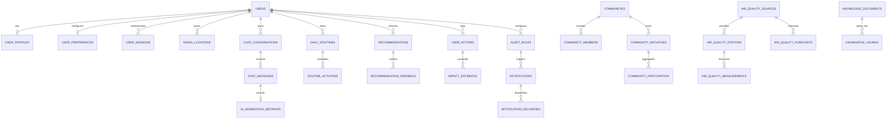

# Database Architecture & Schema: AirWise AI (`database.md`)

AirWise AI uses **PostgreSQL 16+** with **`postgis`** (`GEOGRAPHY(POINT, 4326)`), **`vector`** (`pgvector`), and **`uuid-ossp`**.

---

## 1. Entity-Relationship Overview

---

## 2. Core Table Specifications (27 Tables)

### 2.1 Identity, Governance & Locations
1. **`users`**: `id (UUID PK)`, `email (CITEXT UNIQUE NOT NULL)`, `password_hash (TEXT NULL for OAuth-only)`, `role (VARCHAR: user|moderator|admin)`, `is_email_verified (BOOL)`, `is_active (BOOL)`, `created_at`, `updated_at`, `deleted_at`.
2. **`user_profiles`**: `user_id (UUID PK/FK -> users)`, `display_name`, `locale (default 'en')`, `preferred_aqi_standard ('india_naqi'|'us_epa')`, `timezone`, `updated_at`.
3. **`user_sessions`**: `id (UUID PK)`, `user_id (FK -> users)`, `refresh_token_hash (TEXT UNIQUE)`, `csrf_secret_hash (TEXT)`, `ip_hash`, `user_agent`, `expires_at`, `revoked_at`, `created_at`. Index: `(user_id, revoked_at)`.
4. **`user_preferences`**: `user_id (UUID PK/FK -> users)`, `age_category`, `household_size`, `has_vulnerable_members (BOOL NULL)`, `work_schedule (JSONB)`, `school_schedule (JSONB)`, `commute_modes (TEXT[])`, `cooking_type`, `ventilation_type`, `has_hepa_purifier (BOOL)`, `budget_tier`, `sustainability_goals (TEXT[])`, `consent_updated_at`.
5. **`saved_locations`**: `id (UUID PK)`, `user_id (FK -> users)`, `label ('home'|'workplace'|'school'|'other')`, `display_name`, `city`, `state_region`, `country_code`, `postal_code`, `coordinates (GEOGRAPHY(POINT, 4326) NULL)`, `location_precision ('city'|'postal_code'|'neighborhood'|'exact')`, `timezone`, `is_primary (BOOL)`, `created_at`. Spatial GIST index on `coordinates`; partial unique index `(user_id) WHERE is_primary = true`.

### 2.2 Environmental Telemetry & Weather
6. **`air_quality_sources`**: `id (UUID PK)`, `slug UNIQUE`, `name`, `provider_type`, `license_note`, `refresh_interval_seconds`, `is_enabled`, `priority_rank`.
7. **`air_quality_stations`**: `id (UUID PK)`, `source_id (FK)`, `external_station_id`, `name`, `city`, `state_region`, `country_code`, `coordinates (GEOGRAPHY(POINT, 4326))`, `source_type ('station'|'model')`, `is_active`. GIST index on `coordinates`; unique `(source_id, external_station_id)`.
8. **`air_quality_measurements`** *(Monthly UTC Range Partitioned on `measured_at`)*: `id (UUID)`, `station_id (FK)`, `source_id (FK)`, `pollutant ('pm25'|'pm10'|'no2'|'so2'|'co'|'o3')`, `concentration (NUMERIC(10,4))`, `unit ('ug/m3'|'mg/m3'|'ppb'|'ppm')`, `averaging_period_hours (SMALLINT)`, `measured_at (TIMESTAMPTZ)`, `source_timezone`, `ingested_at (TIMESTAMPTZ)`, `quality_flag`. Composite index: `(station_id, pollutant, measured_at DESC)`.
9. **`air_quality_forecasts`**: `id (UUID PK)`, `source_id (FK)`, `city`, `coordinates (GEOGRAPHY(POINT, 4326))`, `forecast_for (TIMESTAMPTZ)`, `generated_at (TIMESTAMPTZ)`, `pollutants (JSONB)`, `confidence_level`.
10. **`weather_observations`**: `id (UUID PK)`, `city`, `coordinates (GEOGRAPHY(POINT, 4326))`, `temperature_c`, `humidity_pct`, `wind_speed_mps`, `wind_direction_deg`, `inversion_risk_flag (BOOL NULL)`, `observed_at (TIMESTAMPTZ)`, `provider`.

### 2.3 Conversational AI & RAG Knowledge Base
11. **`chat_conversations`**: `id (UUID PK)`, indexed `user_id (FK -> users)`, `created_at`. Every history query is owner-scoped. Bounded earlier-action summaries are assembled per request rather than persisted.
12. **`chat_messages`**: `id (UUID PK)`, indexed `conversation_id (FK -> chat_conversations)`, `role ('user'|'assistant')`, `content (TEXT)`, `structured_response (JSONB NULL, includes citations)`, `created_at`.
13. **`ai_generation_metadata`**: `id (UUID PK)`, unique `message_id (FK -> chat_messages)`, `request_id`, `model_name`, `prompt_version`, `tools_invoked (JSONB)`, `token_usage (INT)`, `latency_ms (INT)`, `fallback_reason (NULL when generated)`, `created_at`. No raw prompts or fabricated cost accounting.
14. **`knowledge_documents`**: `id (UUID PK)`, `title`, `publisher`, unique `source_url`, nullable `publication_date` (unknown dates are not invented), `last_reviewed_date`, `jurisdiction`, `content_hash (CHAR(64))`, `trust_classification`, `created_at`. Initial ingestion/retrieval is restricted to approved Tier-1 official sources.
15. **`knowledge_chunks`**: `id (UUID PK)`, indexed `document_id (FK -> knowledge_documents)`, `chunk_index (INT)`, `content (TEXT)`, `content_hash`, `embedding (VECTOR(768))`, `embedding_model_version`. Unique `(document_id, chunk_index)`, HNSW cosine index and GIN `to_tsvector('english', content)` index.
16. **`knowledge_ingestion_jobs`**: `id (UUID PK)`, `source_url`, `status ('pending'|'running'|'succeeded'|'failed')`, `error_code`, `created_at`, `completed_at`.

### 2.4 Recommendations, Routines & Impact Accounting
17. **`daily_routines`**: `id (UUID PK)`, `user_id (FK -> users)`, `location_id (FK -> saved_locations NULL)`, `plan_date (DATE)`, `aqi_standard`, `status ('draft'|'confirmed'|'archived')`, `environmental_snapshot_at (TIMESTAMPTZ)`, `created_at`, `updated_at`.
18. **`routine_activities`**: `id (UUID PK)`, `routine_id (FK -> daily_routines)`, `time_block ('morning'|'midday'|'afternoon'|'evening'|'night')`, `start_time (TIME)`, `duration_minutes (INT)`, `title`, `environment_type ('indoor'|'outdoor'|'transit')`, `exposure_note`, `safer_alternative`, `explanation`, `impact_estimate_id (FK NULL)`, `confidence`.
19. **`recommendations`**: `id (UUID PK)`, `user_id (FK -> users)`, `category ('routine'|'transport'|'indoor_air'|'household_sustainability'|'community')`, `priority ('critical'|'high'|'medium'|'low')`, `title`, `reason`, `action_steps (JSONB)`, `impact_estimate_id (FK NULL)`, `evidence_document_ids (UUID[])`, `valid_until (TIMESTAMPTZ)`, `created_at`.
20. **`recommendation_feedback`**: `id (UUID PK)`, `recommendation_id (FK)`, `user_id (FK)`, `status ('helpful'|'not_relevant'|'completed'|'dismissed')`, `note`, `created_at`.
21. **`emission_factors`**: `id (UUID PK)`, `category ('transport'|'electricity_grid'|'fuel')`, `mode_or_region_code`, `factor_value (NUMERIC(12,6))`, `unit ('kg_co2e_per_pkm'|'kg_co2e_per_vkm'|'kg_co2e_per_kwh')`, `default_occupancy (NUMERIC(4,2) NULL)`, `source_reference`, `effective_year (INT)`, `is_active`.
22. **`user_actions`**: `id (UUID PK)`, `user_id (FK -> users)`, `action_type`, `quantity (NUMERIC(10,2))`, `unit`, `occurred_at (TIMESTAMPTZ)`, `is_self_reported (BOOL DEFAULT true)`, `created_at`.
23. **`impact_estimates`**: `id (UUID PK)`, `user_id (FK -> users NULL)`, `user_action_id (FK NULL)`, `metric ('transport_co2e'|'household_energy_co2e'|'indoor_filtration_ach'|'relative_exposure_index')`, `baseline_value (NUMERIC(12,4))`, `alternative_value (NUMERIC(12,4))`, `estimated_difference (NUMERIC(12,4))`, `unit`, `methodology`, `assumptions (JSONB)`, `source_references (JSONB)`, `confidence ('low'|'medium'|'high')`, `is_estimate (BOOL DEFAULT true CHECK (is_estimate = true))`, `calculated_at (TIMESTAMPTZ)`.

### 2.5 Smart Alerts, Community & Auditing
24. **`alert_rules`**: `id (UUID PK)`, `user_id (FK -> users)`, `location_id (FK -> saved_locations)`, `alert_type`, `aqi_standard`, `threshold_value (INT NULL)`, `channels (TEXT[])`, `quiet_hours_start (TIME NULL)`, `quiet_hours_end (TIME NULL)`, `cooldown_minutes (INT DEFAULT 180)`, `timezone`, `is_enabled (BOOL)`, `created_at`.
25. **`notifications`** & **`notification_deliveries`**:
    - `notifications`: `id (UUID PK)`, `user_id (FK)`, `alert_rule_id (FK NULL)`, `title`, `body`, `dedup_key`, `read_at`, `created_at`.
    - `notification_deliveries`: `id (UUID PK)`, `notification_id (FK)`, `channel ('in_app'|'email'|'web_push')`, `status ('pending'|'sent'|'failed'|'suppressed_quiet_hours')`, `provider_message_id`, `attempt_count`, `delivered_at`.
26. **`communities`**, **`community_members`**, **`community_initiatives`**, **`community_participation`** *(Community domain)*:
    - `communities`: `id`, `slug UNIQUE`, `name`, `city`, `coarse_boundary_label`, `description`, `moderation_policy`, `created_by`, `created_at`. *(Never stores household street addresses.)*
    - `community_members`: `(community_id, user_id)` composite PK, `role ('member'|'moderator')`, `public_display_consent (BOOL DEFAULT false)`, `joined_at`.
    - `community_initiatives`: `id`, `community_id (FK)`, `title`, `challenge_type`, `starts_at`, `ends_at`, `moderation_status`.
    - `community_participation`: `id`, `initiative_id (FK)`, `user_id (FK)`, `self_reported_actions_count`, `estimated_avoided_co2e_kg`, `reported_at`.
27. **`audit_logs`** & **`system_settings`**:
    - `audit_logs`: `id (UUID PK)`, `actor_user_id (UUID NULL — SET NULL on account deletion)`, `action`, `target_type`, `target_id`, `metadata_redacted (JSONB)`, `ip_hash`, `created_at`. Append-only.
    - `system_settings`: `key (TEXT PK)`, `value (JSONB)`, `updated_by`, `updated_at`.

---

## 3. Transaction, Deletion & Retention Policies

- **No Blind Cascades:** Deleting a user (`DELETE /api/v1/users/me`) executes an explicit service transaction that deletes `saved_locations`, `user_preferences`, `user_sessions`, `chat_conversations`/`chat_messages`, `daily_routines`, `alert_rules`, and `notifications`, anonymizes `community_participation` aggregates if retained, and sets `actor_user_id = NULL` on `audit_logs`.
- **Retention:** Expired `user_sessions` are purged after 30 days; `air_quality_measurements` raw partitions older than configurable retention (e.g., 24 months) roll up into daily aggregates.
