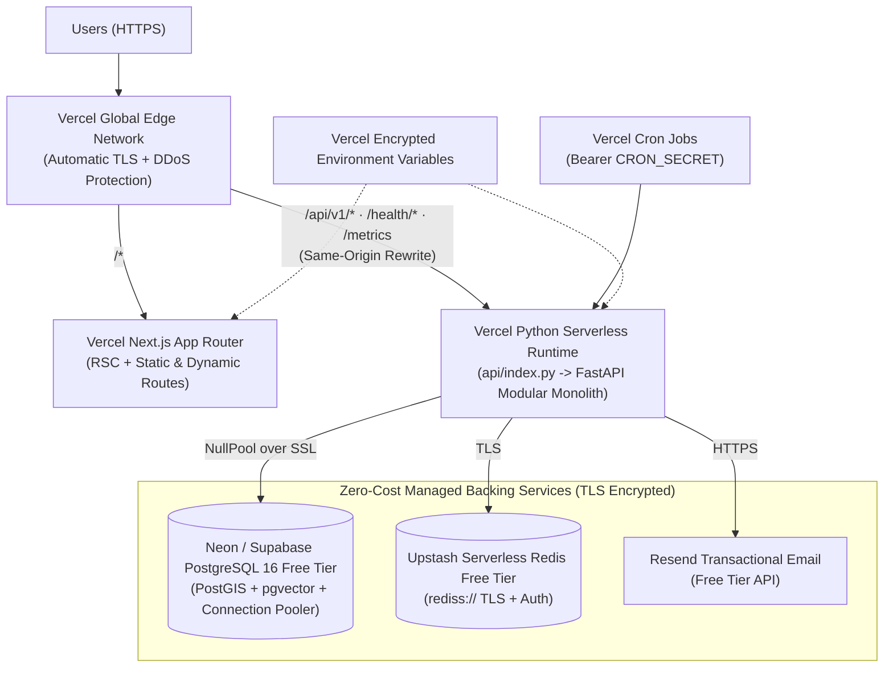

# Deployment & Operations Guide (`deployment.md`)

AirWise AI supports reproducible local execution via Docker Compose and **zero-cost (`$0/month`) cloud deployment on Vercel's Free (Hobby) Tier** paired with free-tier managed serverless **Neon/Supabase PostgreSQL 16 (PostGIS + pgvector)** and **Upstash Serverless Redis**.

---

## 1. Local Container Topology (`docker-compose.yml`)

| Service | Image / Build | Network Exposure | Role |
| :--- | :--- | :--- | :--- |
| `frontend` | `./frontend/Dockerfile` | `127.0.0.1:3000` (`edge`) | Next.js App Router server |
| `backend` | `./backend/Dockerfile` | `127.0.0.1:8000` (`edge` + `internal`) | FastAPI `/api/v1`, SSE, health probes |
| `worker` | `./backend/Dockerfile` | `internal` only | Celery worker (`ingestion`, `alerts`) |
| `scheduler` | `./backend/Dockerfile` | `internal` only | Singleton Celery Beat scheduler |
| `postgres` | `postgis/postgis:16-3.4` + `pgvector` | `internal` only (never public) | Primary relational/spatial/vector DB |
| `redis` | `redis:7.4-alpine` | `internal` only (never public) | Cache, rate limits, Celery broker |

---

## 2. Zero-Cost Cloud Architecture (Vercel + Neon/Supabase + Upstash)



### Why Same-Origin Vercel Hosting Fits AirWise Security
- **Zero Cost (`$0/month`):** Eliminates paid VPC NAT gateways, load balancers, and always-on container/database hourly charges.
- **Same-Origin Cookie & CSRF Security:** Because `vercel.json` rewrites `/api/v1/*` to `api/index.py` on the exact same domain as the Next.js UI, `HttpOnly`, `Secure`, `SameSite=Lax` session cookies and double-submit `X-CSRF-Token` headers work natively across all browsers (including strict mobile Safari ITP) without third-party cookie workarounds.
- **Serverless Connection Pooling:** When `VERCEL=1` or `DATABASE_SERVERLESS_POOL=true`, `backend/app/db/session.py` uses SQLAlchemy `NullPool` so short-lived serverless invocations never exhaust PostgreSQL connections against Neon/Supabase's pooled endpoint.

### Production Environment Variables (Vercel Project Settings)
- Set `APP_ENV=production`, `DEBUG=false`, `AUTH_COOKIE_SECURE=true`, `DATABASE_SERVERLESS_POOL=true`, and a cryptographically random 64-byte `AUTH_SECRET_KEY`.
- Set `NEXT_PUBLIC_API_BASE_URL=/api/v1` so browser requests route same-origin through Vercel rewrites.
- Set `DATABASE_URL` to your Neon/Supabase pooled `postgresql+asyncpg://...` connection string (with `postgis`, `vector`, `citext`, and `uuid-ossp` enabled) and `REDIS_URL` to your Upstash `rediss://...` endpoint.
- Set `CRON_SECRET` (automatically sent as `Authorization: Bearer <CRON_SECRET>` by Vercel Cron to `/api/v1/system/cron/daily-maintenance`).
- Keep `AIR_QUALITY_PROVIDER` set to verified production providers (`openaq` / `openweather`)—`fixture` mode is rejected at startup when `APP_ENV=production`.
- Restrict `/metrics` with `METRICS_INTERNAL_TOKEN`.

---

## 3. CI/CD, Database Migrations & Rollback Runbook

1. **CI Pipeline (`.github/workflows/ci.yml`):** Runs Ruff, MyPy, Pytest (unit + integration + security + contract), ESLint, `tsc --noEmit`, Vitest, and Next.js/Docker build verification on every PR.
2. **Gated Production Release (`.github/workflows/deploy.yml`):**
   - Requires manual GitHub `production` environment approval before running `alembic upgrade head` against `DATABASE_URL` and deploying the prebuilt bundle via `vercel deploy --prod`.
   - **Expand-and-Contract Migrations:** Schema changes must remain backward-compatible with the previous deployment (`N-1`) during atomic Vercel alias promotions.
3. **Rollback Procedure:**
   - **Application Rollback:** Promote the previous immutable deployment instantly via `vercel rollback` (or the Vercel Dashboard Instant Rollback button) and verify `/health/ready`.
   - **Database Rollback:** Create a zero-copy Neon branch / Supabase point-in-time backup prior to migration; for reversible additive migrations run `alembic downgrade -1`; for data-corrupting emergencies switch `DATABASE_URL` to the restored pre-migration branch.

---

## 4. Backup, Restore & Observability Alerting Runbook

### 4.1 Scheduled Backup & Restore Verification
1. **Managed Point-in-Time Recovery (PITR):** Enable Neon History Retention (7-day free window) or Supabase daily automated backups on the primary PostgreSQL 16 database.
2. **Pre-Release Logical Snapshot:**
   ```bash
   pg_dump --format=custom --no-owner --no-acl "$DATABASE_URL" -f airwise_pre_release.dump
   ```
3. **Restore Drill (Isolated Branch / Staging):**
   ```bash
   pg_restore --clean --if-exists --no-owner --dbname="$STAGING_DATABASE_URL" airwise_pre_release.dump
   cd backend && alembic current && pytest tests/contract -q
   ```

### 4.2 Prometheus & OpenTelemetry SLO Thresholds
- Scrape `/metrics` with `X-Metrics-Token: <METRICS_INTERNAL_TOKEN>`:
  - **Cached AQI Latency SLO:** `airwise_http_latency_p95_ms < 300` (warn at `>= 300ms`, page at `>= 500ms`).
  - **HTTP 5xx Error Budget:** Rate of `airwise_http_errors_total` `< 1%` over 5 minutes.
  - **AI Safe-Fallback Spike:** Alert when `airwise_llm_fallback_total / airwise_llm_requests_total > 0.25` over 15 minutes (indicates upstream Gemini quota/outage or corpus drift).
- Set `OTEL_EXPORTER_OTLP_ENDPOINT` to export redacted FastAPI traces (`Authorization` and `Cookie` headers stripped by `infrastructure/monitoring/otel-collector-config.yaml`).

### 4.3 Production Go-Live Checklist
- [ ] `APP_ENV=production`, `DEBUG=false`, `AUTH_COOKIE_SECURE=true`, `AIR_QUALITY_PROVIDER != fixture`.
- [ ] Cryptographic 64-byte `AUTH_SECRET_KEY`, `CRON_SECRET`, and `METRICS_INTERNAL_TOKEN` rotated in Vercel Encrypted Secrets.
- [ ] `alembic upgrade head`, `python -m scripts.seed_reference_data`, and `python -m scripts.ingest_knowledge` executed against production PostgreSQL (`postgis` + `vector` enabled).
- [ ] `/health/live` and `/health/ready` return `status: "ready"` with `checks.database: "ok"`.
