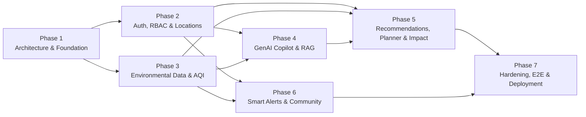

# Master Implementation Plan: AirWise AI (`planning.md`)

This document defines the 7-phase incremental engineering plan, dependency graph, critical path, external integration matrix, risk mitigations, validation gates, and Definition of Done for **AirWise AI**.

---

## 1. Phase Dependency & Critical Path Overview

- **Critical Path:** `Phase 1 -> Phase 3 (AQI & Telemetry) + Phase 2 (Auth & Locations) -> Phase 4 (Copilot & RAG) -> Phase 5 (Recommendation, Routine & Impact Engines) -> Phase 7 (Hardening & Release)`.
- **Parallelizable Track:** Once Phases 2 and 3 complete, **Phase 6 (Alerts & Community)** can proceed in parallel with Phases 4 and 5.

---

## 2. Phase-by-Phase Delivery Plan

### Phase 1: Architecture & Foundation *(Completed)*
- **Deliverables:**
  - Monorepo scaffold (`frontend/`, `backend/`, `infrastructure/`, `docs/`, `.agents/skills/`, `.github/workflows/`).
  - Complete architecture, PRD, API, database, AI, safety, methodology, privacy, and deployment specs.
  - Local `docker-compose.yml` (`postgres` with PostGIS + pgvector, `redis`, `backend`, `worker`, `scheduler`, `frontend`) and `docker-compose.test.yml`.
  - FastAPI application shell (`/health/live`, `/health/ready`, `/metrics`, correlation-ID middleware, standardized `/api/v1` envelopes) + core deterministic calculators & unit tests.
  - Next.js strict TypeScript App Router shell with AirWise WCAG AA design tokens, typed API/SSE client, and route groups.
  - GitHub Actions CI workflow (`lint`, `typecheck`, `test`, Docker build).
- **Acceptance Criteria:**
  - Repo builds cleanly; backend unit tests pass; health probes respond with standardized metadata; CI workflow validates both stacks.

### Phase 2: Authentication, Profiles, Preferences & Location Intelligence *(Completed)*
- **Deliverables:**
  - Alembic initial migration for `users`, `user_profiles`, `user_sessions`, `user_preferences`, `saved_locations` (PostGIS), and `audit_logs`.
  - Argon2id registration/login, `HttpOnly` cookie sessions, double-submit CSRF middleware, refresh-token rotation, email verification & password reset flows, optional Google OAuth adapter.
  - Role-based (`guest`, `user`, `moderator`, `admin`) and object-level authorization dependencies.
  - Consent-first city search, postal lookup, map pin, and optional browser geolocation with `location_precision` tracking.
  - Self-service JSON account export (`GET /api/v1/users/me/export`) and account deletion (`DELETE /api/v1/users/me`).
- **Acceptance Criteria:**
  - Registration, login, logout, session revocation, and CSRF checks pass integration tests; cross-user IDOR tests confirm 403/404 isolation; guest users retain public AQI access.

### Phase 3: Real-Time Air Quality & Weather Intelligence *(Current Baseline — Completed)*
- **Deliverables:**
  - Alembic migrations for `air_quality_sources`, `air_quality_stations`, `air_quality_measurements` (range-partitioned), `air_quality_forecasts`, and `weather_observations`.
  - Provider-independent ingestion adapters (OpenAQ primary, OpenWeather fallback, CPCB/regional adapter interface, and explicitly flagged `fixture` dev adapter) with HTTPX timeouts, retries, and circuit breakers.
  - Isolated `us_epa` and `india_naqi` calculators, Redis caching, stale-data detection, and Celery Beat scheduled ingestion tasks.
  - Public (`/air-quality`, `/air-quality/[city]`) and authenticated (`/dashboard`, `/dashboard/air-quality`) views with Recharts 24h/7d/30d trends, MapLibre station map, and non-color-only AQI badges.
- **Acceptance Criteria:**
  - Live or explicitly labeled fixture readings render end-to-end; primary-to-fallback failover works; stale cache entries display staleness warnings; US EPA and India NAQI never mix breakpoints.

### Phase 4: AirWise Copilot & Trusted RAG Knowledge Base
- **Deliverables:**
  - Alembic migrations for `knowledge_documents`, `knowledge_chunks` (`pgvector`), `knowledge_ingestion_jobs`, `chat_conversations`, `chat_messages`, and `ai_generation_metadata`.
  - Document ingestion CLI/worker (chunking, content hashing, embedding generation, trust/freshness metadata) seeded with curated WHO, US EPA, and national public-health advisories.
  - Provider-independent LLM gateway (Gemini structured JSON outputs and Gemini embeddings initial adapter) + versioned `AIRWISE_COPILOT_SYSTEM_PROMPT_V1`.
  - 14-stage orchestration pipeline, 12 allowlisted RBAC-gated tools, post-LLM citation & numerical verifier, bounded retry, and safe deterministic fallback.
  - SSE streaming endpoint (`POST /api/v1/assistant/chat/stream`) with cancellation propagation and `/dashboard/assistant` UI.
- **Acceptance Criteria:**
  - Copilot calls only authorized tools, streams partial deltas + citations, refuses fabricated readings, neutralizes prompt-injection payloads, and passes the 12-scenario AI evaluation suite.

### Phase 5: Hybrid Recommendations, Daily Routine Planner & Impact Engine
- **Deliverables:**
  - Alembic migrations for `recommendations`, `recommendation_feedback`, `daily_routines`, `routine_activities`, `user_actions`, `impact_estimates`, and `emission_factors`.
  - Deterministic safety rule engine (severe smog exercise blocks, vulnerable-household rules, window/ventilation rules, indoor filtration guidance).
  - Hybrid recommendation generator (`/api/v1/recommendations/*`) across all 5 categories.
  - Interactive time-slotted Daily Routine Planner (`/api/v1/routines/*` and `/dashboard/routine-planner`) with edit/regenerate/save flows.
  - Transportation, household energy, indoor filtration, and relative exposure pages (`/dashboard/transport`, `/dashboard/indoor-air`, `/dashboard/impact`).
- **Acceptance Criteria:**
  - Exposure safety overrides transport emissions in every severe-pollution test case; LLM never alters deterministic impact numbers; schedules never mutate without user confirmation.

### Phase 6: Smart Alerts & Neighborhood Community Module
- **Deliverables:**
  - Alembic migrations for `alert_rules`, `notifications`, `notification_deliveries`, `communities`, `community_members`, `community_initiatives`, and `community_participation`.
  - Celery alert evaluation pipeline with threshold/forecast/window triggers, Redis deduplication, cooldown windows, timezone-aware quiet hours, in-app + email + optional web-push delivery, and opt-out controls.
  - Community groups, clean-air challenges, voluntary action logging, privacy-preserving aggregate metrics, moderation queue, and abuse reporting (`/dashboard/community`, `/admin/community`).
- **Acceptance Criteria:**
  - Unchanged AQI conditions do not spam duplicate alerts; quiet hours are honored; community dashboards never leak exact household coordinates or unconsented PII.

### Phase 7: Hardening, Observability, Full E2E & Cloud Deployment
- **Deliverables:**
  - Admin console (`/admin/*`) for data sources, RAG corpus governance, AI token/cost/latency monitoring, moderation, and audit logs.
  - Full Playwright 13-step E2E suite, Lighthouse/axe WCAG 2.2 AA audit (`>= 90`), load/latency benchmarking (`p95 < 300ms` cached AQI, `< 500ms` API), and security review.
  - OpenTelemetry + Prometheus dashboards/alerts, zero-cost cloud deployment manifests (`vercel.json` + `api/index.py` on Vercel Free Tier + Neon/Supabase Free PostgreSQL + Upstash Free Serverless Redis), backup/restore & migration rollback runbooks.
- **Acceptance Criteria:**
  - All 13 E2E steps pass in CI; zero critical security or accessibility findings; deployment and rollback runbooks validated.

---

## 3. External API & Service Integration Matrix

| Domain | Primary Adapter | Fallback / Local Dev Strategy | Required Credentials |
| :--- | :--- | :--- | :--- |
| **Air Quality** | OpenAQ v3 REST API | OpenWeather Air Pollution API; CPCB regional feed; `fixture` adapter (explicitly labeled) | `AIR_QUALITY_API_KEY` |
| **Weather** | OpenWeather One Call / Current | Open-Meteo (keyless non-commercial dev option) or labeled `fixture` adapter | `WEATHER_API_KEY` |
| **Geocoding** | Mapbox / OpenWeather Geocoding | Curated city/station gazetteer table + manual map coordinates | `GEOCODING_API_KEY` |
| **LLM & Embeddings** | Gemini API (`GEMINI_MODEL`, default `gemini-2.5-flash`; `gemini-embedding-001`, 768 dimensions) | Provider-independent gateway interface + explicit deterministic safety fallback when unavailable | `GEMINI_API_KEY` |
| **Transactional Email** | Resend (Free Tier API) | Local SMTP sink (Mailpit) or structured console transport in development | `EMAIL_API_KEY` |

---

## 4. Technical Risk Register & Mitigations

| Risk | Impact | Mitigation |
| :--- | :--- | :--- |
| **Upstream AQI station outages or missing pollutants** | Incorrect AQI if naively computed | Strict calculator preconditions (e.g., India NAQI 3-pollutant + PM rule); circuit breaker failover; explicit `unavailable` / `is_stale` states. |
| **LLM hallucinating health stats, citations, or CO2e math** | User trust & safety hazard | Deterministic calculators own all math; post-generation citation ID & numerical verification; structured JSON schema enforcement. |
| **Indirect prompt injection via retrieved documents or community text** | Policy bypass or data leak | Untrusted content delimiters, strict 12-tool allowlist, per-user repository scoping outside the prompt boundary. |
| **Alert fatigue during prolonged multi-day winter smog** | Users disable notifications | State-transition deduplication, configurable cooldown windows, quiet hours, and consolidated daily digests. |
| **High LLM token spend under traffic spikes** | Runaway cloud cost | Sliding-window per-user token budgets, rolling conversation summarization, embedding reuse, and model routing by intent complexity. |

---

## 5. 15-Point Definition of Done (Mandatory Gate)

A feature may transition to `Done` **only** when all 15 criteria are verified:
- [ ] 1. Frontend UI exists with responsive mobile-to-desktop layout.
- [ ] 2. Backend `/api/v1/` endpoint exists and is documented in OpenAPI.
- [ ] 3. Strict Pydantic v2 & TypeScript request/response schemas are aligned.
- [ ] 4. PostgreSQL persistence & reversible Alembic migration work cleanly.
- [ ] 5. Authentication, CSRF, and object-level RBAC are enforced on the backend.
- [ ] 6. Accessible skeleton loading states are implemented.
- [ ] 7. Explicit error, stale-data, and unmeasured/empty states are implemented.
- [ ] 8. Client (Zod) and server (Pydantic) validation are enforced.
- [ ] 9. Automated unit, integration, and UI tests are written and executed.
- [ ] 10. Relevant `docs/` files are updated.
- [ ] 11. Frontend and backend are wired end-to-end (no mock UI stubs).
- [ ] 12. Zero fabricated environmental data or fake citations are shown.
- [ ] 13. WCAG 2.2 AA contrast, keyboard navigation, and non-color-only badges pass.
- [ ] 14. Security & privacy review (PII minimization, log redaction, SSRF/XSS) passes.
- [ ] 15. Phase-specific acceptance criteria pass.
